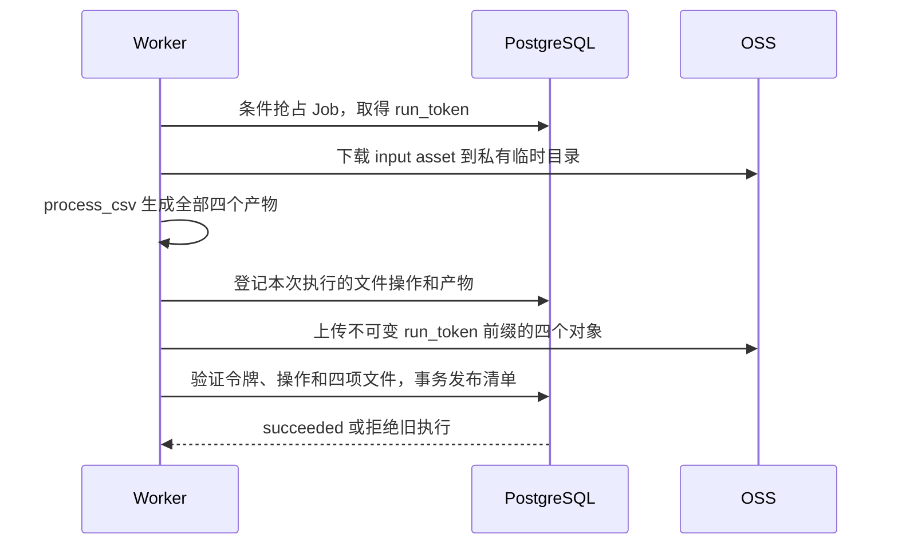

# 01 多机对象存储：从本地卷迁移到阿里云 OSS

> 状态：实施指南，尚未实现。统一模型与迁移约定见 [总览](README.md)。

## 1. 当前实现与问题

[api.py](../app/api.py) 在 `storage_dir/<job_id>/input.part` 接收文件，重命名为 `input.csv` 后保存 `Job.input_path`。[jobs.py](../app/jobs.py) 在本地临时目录生成结果，目录重命名后保存 `result_path`。下载通过本地 `FileResponse` 返回。

[compose.yaml](../compose.yaml) 的 `files` named volume 在当前 Docker 主机内供多个容器共用。把 worker 放到另一台 ECS 后，它并不会自动得到 API 所在主机的文件。因此需要把长期文件放到所有实例可访问的共同存储中。

目标是：API A 接收上传，worker B 处理，API C 仍可查询和下载；重启或替换任一计算实例不影响已发布文件。本文选择阿里云 OSS，保留本地适配器用于开发。

## 2. 存储布局与鉴权边界

建议使用私有 Bucket，并为不同环境使用不同 Bucket 或严格隔离的前缀。键全部由服务端生成：

```text
dataclean/prod/users/<user_id>/jobs/<job_id>/uploads/<operation_id>/input.csv
dataclean/prod/users/<user_id>/jobs/<job_id>/runs/<run_token>/cleaned.csv
dataclean/prod/users/<user_id>/jobs/<job_id>/runs/<run_token>/report.json
dataclean/prod/users/<user_id>/jobs/<job_id>/runs/<run_token>/statistics.csv
dataclean/prod/users/<user_id>/jobs/<job_id>/runs/<run_token>/rejected.csv
```

键含 `user_id` 只是组织方式。下载仍须经过现有 `current_user()` 和 `owned_job()`；禁止接受浏览器传来的任意 bucket/key 后替它签名。原始文件名只用于受控的下载文件名，不参与对象路径拼接。

阿里云官方支持 ECS 实例 RAM 角色获取临时凭证，避免在代码中嵌入长期 AccessKey，见参考 [1]。建议 API 只拥有业务前缀的写入、读取/签名权限；worker 读取输入、写入产物；清理服务才拥有对应前缀的删除、必要的列表权限。按使用的 API 实际核验 RAM 策略，不直接授予整个账号的 OSS 管理权限。

一台 ECS 只能绑定一个实例 RAM 角色。同机容器若都可访问实例元数据，通常能获得同一角色权限；仅用不同环境变量不能形成权限隔离。需要严格区分 API、worker、清理器权限时，使用不同角色的 ECS/独立工作负载身份或经过验证的 STS 授权方案，并控制元数据访问。单机首版若共用角色，应明确它拥有这些组件所需权限的并集，不宣称容器之间已实现 RAM 权限分离。

## 3. 数据模型：先登记，再写入

在 [models.py](../app/models.py) 增加以下模型；本节字段是建议方案。

| 模型/字段 | 用途 |
| --- | --- |
| `FileOperation.id/kind/user_id/job_id/run_token` | 表示一次 upload、job_run 或 migration；上传时 job_id 可以是尚未创建任务的预生成 UUID，不设强制外键 |
| `FileOperation.status/expires_at/fencing_version` | 持久写入意图、可续约的写入期限、阻止旧写入者发布 |
| `FileAsset.id/operation_id/user_id/job_id` | 唯一文件登记和归属；job_id 在上传提交时再建立关联 |
| `backend/bucket/object_key/version_id` | local 或 oss 的定位信息；本地记录相对路径，OSS 记录键，禁止混用绝对路径 |
| `role/run_token/state` | input 或四类产物、所属执行、planned 到 deleted 的生命周期 |
| `size_bytes/sha256/created_at/deleted_at` | 实际字节数、应用层内容校验、回收时间 |
| `write_lease_expires_at/delete_after` | 写入保护与删除延迟，供清理器使用 |
| `Job.input_asset_id` | 正式输入引用，逐步替代 input_path |
| `Job.result_manifest` | 由服务端生成的四类产物与 asset_id 映射，逐步替代 result_path |

对存储标识建立唯一约束，包含 backend、bucket、key 和明确的版本标识；不启用版本控制时用约定的非空版本占位值，避免 NULL 唯一性遗漏。对 `(job_id, run_token, role)`、操作状态与期限建立查询索引。

上传前先提交 `FileOperation(open)` 和 `FileAsset(planned)`，再执行外部写入。不能等上传成功后才登记，否则中途强杀后无法区分孤儿和仍在上传的文件。操作过期由 04 的清理流程接管，发布者必须再次验证操作仍然 open、期限有效且围栏版本相同。

## 4. 上传完整流程

1. 保留登录、CSV 扩展名、实际接收字节数及 10 MiB 单文件上限。首版继续由 API 接收文件，暂不改为浏览器直传。
2. 创建上传操作并预留配额，具体见 [02 用户配额](02_用户配额.md)。文件先落 API 专有临时目录，分块计算 SHA-256；长上传需要续约操作，不持有数据库事务等待网络。
3. 根据 SHA-256 或 `Idempotency-Key` 查询已有任务。相同键同内容返回原任务，不重复创建业务任务；不同内容仍返回 409。临时空间和配额按该操作清理、结算。
4. 为新输入登记不可变对象键，上传到 OSS；记录实际大小、SHA-256，必要时读取对象元数据确认。对象元数据不是唯一真相，应用保留自己的 SHA-256；不要把 ETag 一律当成文件 MD5。
5. 短事务中复核配额、操作围栏与文件完整性，插入 queued Job，把 input asset 标为 active、操作标为 committed，并结算输入配额。
6. 若两个请求在最终唯一约束处竞争，只有一个任务提交成功；另一个重新查询现有任务，其私有上传对象进入 delete_pending，确认删除后释放占用。
7. 数据库提交响应丢失时，先通过操作 ID 和幂等键重新查询，不可直接删除对象。数据库无法确认时保留对象并交给后续对账。
8. dispatcher 继续仅投递已提交的 queued 任务。API 上传到 OSS 失败时不发布 queued，不能创建一个没有可读输入的任务。

可见行为保持“上传后返回任务编号”；输入尚未持久化成功时不会返回可执行任务。

## 5. worker 与结果发布流程



1. 保留 `claim_job()`、续租和 `run_token` 条件更新，将 `process_csv(source: Path, destination: Path)` 保持为本地离线函数。
2. 下载到 worker 自己的临时目录；校验输入大小和 SHA-256。临时磁盘要有主机级容量限制，OSS 解决长期共享，不会消除本地计算空间需求。
3. 为本次执行创建 `FileOperation(job_run)`，四个产物先登记再上传。实际大小受到 02 中的输出预留上限控制。
4. OSS 流程采用“不可变对象 + 数据库清单发布”。不要照搬本地目录 rename；所有对象上传完毕前，清单都不可对外下载。
5. 将现有 `finish_job()` 扩展为同一事务：验证 Job 为 running、run_token 相同、输入未进入删除流程、操作围栏有效、四类产物全部 staged，然后激活四项文件、保存清单、结算配额并写 succeeded。
6. 旧执行上传结束但条件提交失败，只能处理自己 token 的对象；禁止按整个 job 前缀递归删除。
7. 产物上传部分成功、提交确认丢失等情况，复用现有“先复查数据库引用，不能确认则保留”的原则，再由 04 安全回收。

## 6. 下载流程与页面修改

保持现有 `/api/jobs/{id}/download/{artifact}` 作为鉴权入口：归属校验 → succeeded → 保留期检查 → 清单白名单 → asset 状态检查。

初版建议鉴权后由 API 流式代理对象内容，前端改动较少，但需要评估 API 的出口流量和并发。后续可改为返回短期预签名 URL：建议有效期 60 秒，并使其不超过文件剩余保留期。

官方说明签名 URL 会向持有者授予临时访问权，见参考 [2]。因此 URL 不能写入公共日志、页面持久缓存或统计事件。密码重置、退出登录不能立即撤销已经发出的 OSS 链接；需要即时撤销语义时使用 API 代理并按请求重新鉴权。

签名必须使用浏览器可达的公网 endpoint；worker 可使用同地域内网 endpoint，地址类型见参考 [4]。不能把只在 VPC 内可达的地址发给公网浏览器。`app/static/app.js` 的 `download()` 应相应处理响应或跳转，并展示链接失效后重新获取的提示。

## 7. 按文件实施

| 位置 | 修改内容 |
| --- | --- |
| 建议新增 `app/storage.py` | 定义 put/get/head/delete/presign 的应用接口和统一异常，隔离 SDK |
| 建议新增 `app/storage_local.py`、`app/storage_oss.py` | 分别实现本地和 OSS；接口骨架不是 SDK 的真实调用签名 |
| `app/models.py`、Alembic 新 revision | 新增文件登记、操作表和兼容引用字段 |
| `app/api.py` | 上传按操作登记，下载根据 asset backend 分流 |
| `app/jobs.py` | 下载输入、生成产物、上传、条件发布及补偿 |
| `app/config.py`、`.env.example` | 增加 provider、region、bucket、内部/外部 endpoint、操作写入期限 |
| `requirements.txt` | 选定并验证阿里云官方 OSS SDK；固定验证过的版本，不凭文档猜最新版 |
| `compose.yaml` | 显式传入新配置；多机部署中本地卷只承载各实例临时文件 |
| `app/static/app.js` | 根据下载模式及过期错误给出可见反馈 |

建议环境变量名：`DATACLEAN_STORAGE_BACKEND`、`DATACLEAN_OSS_REGION`、`DATACLEAN_OSS_BUCKET`、`DATACLEAN_OSS_INTERNAL_ENDPOINT`、`DATACLEAN_OSS_PUBLIC_ENDPOINT`、`DATACLEAN_FILE_OPERATION_LEASE_SECONDS`。它们当前都未实现；凭证提供器遵循所选 SDK 的官方接口，不杜撰环境变量。

阿里云操作顺序：创建测试 Bucket → 设置私有访问 → 配置 RAM 角色和业务前缀策略 → 给测试 ECS 绑定角色 → 从容器验证临时凭证刷新及网络访问 → 用测试对象验证上传/下载/删除 → 再切换业务。不要把本机管理员凭证直接搬进镜像。

## 8. 存量迁移与回滚

1. 备份数据库及本地 files；部署同时支持 local/oss 的代码，新字段先允许空。
2. 暂停旧版 worker 或确保所有 worker 已支持新协议。迁移时跳过 running，避免复制未完成目录。
3. 按 Job 登记 migration 操作，复制输入和成功清单中的四项产物，校验大小、SHA-256，再条件切换该任务引用。记录迁移批次和原始位置。
4. 先迁移少量任务做归属与真实下载验证，再分批迁移；新任务切到 OSS。旧本地文件保留明确的回退窗口，清理器识别迁移保护。
5. 回退先关闭新上传切换，保持双读。已经仅存在 OSS 的任务仍需要支持 OSS 的版本；不能把全局 backend 改回 local 就当作回滚完成。
6. 确认回退窗口结束、引用和配额对账一致后，再单独安排旧副本删除。文件位置以 asset 为准，不在每次失败时静默尝试另一后端。

## 9. 验收场景

| 操作 | 预期结果 |
| --- | --- |
| API 和 worker 使用互不共享的临时目录执行同一任务 | 仍生成四项完整结果并可下载 |
| API A 上传、worker B 处理、API C 下载 | 内容和 SHA-256 一致，替换实例后仍可用 |
| 用户 B 请求用户 A 的下载地址 | 统一 404，不产生签名 URL |
| 四个产物中的第三个上传失败 | 不出现 succeeded，不暴露前两项为成功结果 |
| 旧 run_token 上传完毕时新执行已成功 | 旧执行无法覆盖清单，也不能删除新产物 |
| 对象上传成功后数据库提交确认丢失 | 复查已提交引用，保留有效对象 |
| 强杀上传或 worker 进程 | 存在持久写入意图，过宽限期后可清理 |
| 用浏览器访问签名 URL、等待过期再访问 | 期限内可下载，到期后无法继续新建授权请求 |
| 禁止某个 RAM 操作或撤销访问权限 | 明确失败并记录分类，不伪报成功 |

先做本地适配器与假存储故障测试，再在独立测试 Bucket 验证真实权限、签名 endpoint、多机与 SDK 行为。真实云资源操作应纳入后续实施授权和费用范围。

## 10. 官方参考

1. [阿里云 ECS 实例 RAM 角色](https://www.alibabacloud.com/help/en/ecs/user-guide/attach-an-instance-ram-role-to-an-ecs-instance)：临时凭证与角色绑定。
2. [OSS 使用签名 URL 下载文件](https://www.alibabacloud.com/help/en/oss/user-guide/how-to-obtain-the-url-of-a-single-object-or-the-urls-of-multiple-objects)：临时访问授权与链接有效期。
3. [阿里云官方 OSS Python SDK V2](https://github.com/aliyun/alibabacloud-oss-python-sdk-v2)：安装、上传示例和开发指南入口。
4. [OSS 请求与 endpoint](https://www.alibabacloud.com/help/en/oss/developer-reference/overview-24)：公网、内网 endpoint 与请求地址格式。

产品行为核对日期：2026-10-27。存储状态机、模型与迁移步骤是本项目的建议设计。
