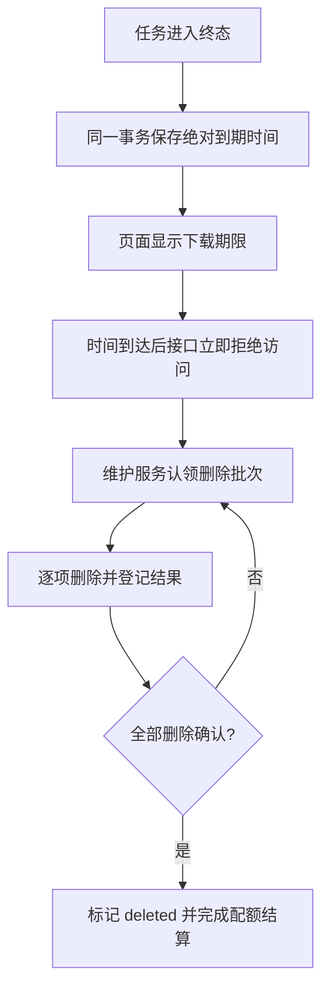

# 03 文件保留期：到期禁用访问与可靠删除

> 状态：实施指南，尚未实现。配合 [02 用户配额](02_用户配额.md) 与 [04 孤儿文件清理](04_自动孤儿文件清理.md)。

## 1. 当前实现与目标

当前 `Job` 只有执行状态和开始/结束时间，文件没有到期时间。[api.py](../app/api.py) 下载在任务成功时直接读本地结果；失败任务可以调用 retry；历史和文件都没有自动到期机制。

目标是让用户事先看到保留期限，到期后停止下载和重试，后台可靠删除输入与产物，保留必要历史元数据。业务上已到期与存储中已删干净是两件事，必须分别记录。

## 2. 建议业务规则

| 事项 | 首版建议 |
| --- | --- |
| 起算点 | 最新一次进入 succeeded/failed/quarantined 的 finished_at |
| 文件保留期 | 默认 7 天，记录为绝对 `files_expires_at` |
| queued/running | 不按完成 TTL 删除；长期等待/执行由独立任务超龄策略处理 |
| 手动重试 | 仅输入完整且未到期时允许；事务中取消旧到期计划，完成后重新起算 |
| 隔离文件 | 默认同样 7 天，管理员调查可设置审计保留标记，见 08 |
| 任务元数据 | 例如保留 90 天；与文件期限分开配置 |
| 到期后访问 | 所有者收到 410 与 `files_expired`；其他用户仍为 404 |
| 配额释放 | 物理删除确认后释放，过期时间一到不直接减少 used |

7 天/90 天只是产品示例。管理员设置保留调查标记时应有权限、原因、截止时间和审计，避免文件永久堆积。

## 3. 建议字段

在 `Job` 增加：

- `file_state`：`available/delete_pending/deleted`，独立于 status。
- `files_expires_at`：当前这批输入与产物的访问截止时间；queued/running 为 NULL。
- `files_deleted_at`：所有相关文件确认删除的时间。
- `purge_generation`：清理批次版本，用于防止过时清理者提交。
- `retention_hold_until/retention_hold_reason`：受控调查保留，可选。
- `metadata_expires_at`：单独控制历史元数据到期，可选。

复用 FileAsset 的 `delete_after/state/deleted_at`，按 `(file_state, files_expires_at, id)` 建索引。历史列表返回 expires_at、file_state、can_download、can_retry 及原因，不暴露 bucket/key。

已有 succeeded/failed 任务按 finished_at 回填；无法确定时间的旧记录先进入人工确认批次。不能给所有存量任务设置“现在立刻过期”。旧 API 与 worker 必须先升级为理解这些字段的版本。

## 4. 正常流程

下载接口不能只依赖维护任务是否及时运行。每次授权都检查 `now >= files_expires_at`，所以维护任务停机不会让过期文件继续下载。

使用 OSS 预签名链接时，链接有效期取“配置签名时长”和“剩余保留期”的较小值；若剩余时间不足以发出有效链接，直接返回 410。已经开始的长下载是否允许完成需要明确产品约定，首版可允许已建立的传输完成；不能承诺到期那一秒强制撤销所有正在传输的数据。

## 5. 删除任务如何实现

建议新增 `app/maintenance.py` 和 `app/retention.py`，运行独立维护进程。调度器每分钟扫描一次只是示例；核心是可重入的数据库认领，而不是依赖只有一个调度实例。

1. 查找已到期、处于终态、未被调查保留的 Job ID，先不在外部 I/O 上持锁。
2. 按统一锁序重读配额、Job、操作和文件，确认没有有效写入、没有被重试，且仍满足到期条件。
3. 条件更新 `file_state=delete_pending`，增加 purge_generation，将文件标记 delete_pending 并保存待删除清单，然后提交。
4. 在事务外逐项删除。对象不存在可作为已删除处理，但权限错误、网络错误、对象版本不符不能都当成功。
5. 逐项确认不存在或收到可验证的删除成功结果后，记录 `FileAsset.deleted_at`，写唯一配额释放事件。
6. 所有输入、已发布结果和本任务应回收的未发布残留都处理完后，条件更新 Job 为 deleted。一个文件删除失败时保持 delete_pending，记录原因与下次执行时间。
7. 多个维护进程可使用短事务批次认领，或 `FOR UPDATE SKIP LOCKED` 限定队列处理。认领超时后允许重新接管，但重复删除与重复扣账必须幂等。

一旦标记 delete_pending，不再允许普通重试、延长保留或重新引用其资产。需要恢复时只有“确认物理删除尚未开始且取消整个批次”的受控流程才可考虑；首版直接要求用户重新上传，避免半删除状态恢复。

## 6. 与重试的并发处理

`POST /api/jobs/{id}/retry` 在同一事务中检查：归属、failed、未隔离、file_state=available、当前时间未到期、输入 asset 为 active 且未进入删除流程、配额允许。

成功时将 Job 置 queued、清空旧 expires_at、取得槽位并取消尚未认领的删除计划。清理器和 retry 都锁同一条 Job 并复核状态，因此只能有一方成功。不能在接口外先查“未过期”，稍后无条件更新 queued。

下载在鉴权检查与实际打开文件之间仍可能遇到删除竞争。接口对已知到期统一返回 410；非到期且预期存在的文件缺失应记录一致性故障并返回受控错误，不能伪装为空文件或将所有 404 都解释成过期。

相同幂等键再次上传仍返回原任务和它的过期信息，不自动复活旧文件。想重新处理时提交新的幂等键/任务，重新进行完整校验和配额检查。

## 7. OSS 生命周期如何配合

阿里云 OSS 生命周期规则支持对象过期、分片清理，以及版本控制下不同版本的处理，见官方参考 [1]。

本项目把数据库驱动的到期流程作为业务主流程。不要简单设置“所有对象写入 7 天后删除”：任务可能排队较久、被重试或被调查保留，OSS 的对象写入时间并不等于最新完成时间。

首版建议仅针对明确隔离的暂存区域配置保守的分片清理；业务 active 前缀不配置会早于应用决定的广泛过期规则。需要 OSS 兜底时，先设计不可复用的待删除前缀/标签或有明确最大寿命的对象类别，并验证不会命中有效引用。

若启用 Bucket 版本控制，删除标记不等于所有历史版本都已释放存储；需要记录 version_id，按版本删除或配套非当前版本生命周期。未确认实际版本回收前，不把逻辑删除视为配额和云账单同时归零。

## 8. 按文件修改

| 位置 | 改动 |
| --- | --- |
| `app/models.py`、Alembic | 增加文件生命周期字段、索引与存量回填 |
| `app/jobs.py` | finish 成功/失败时设置期限；与隔离终态一致 |
| `app/api.py` | 下载和 retry 到期判断、410、幂等重放提示 |
| `app/schemas.py` | 对外返回期限、可操作能力及不可操作原因 |
| 建议新增 `app/retention.py` | 候选选择、认领、逐文件删除、批次完成 |
| 建议新增 `app/maintenance.py` | 统一调度入口，兼容本地和 Celery 部署 |
| `app/static/app.js` | 历史行显示本地时区的绝对到期时间，禁用按钮并解释原因 |
| `app/config.py`、`.env.example`、Compose | `DATACLEAN_FILE_RETENTION_DAYS`、`DATACLEAN_METADATA_RETENTION_DAYS`、扫描批量与周期；新增维护服务显式传参 |

配置改变不应偷偷缩短已有任务的绝对到期时间。首版仅应用于新进入终态的任务，存量重算需要预告和审计。

## 9. 上线与回滚

先部署只显示期限、只观察候选的版本，核对用户和对象清单；设置一小批测试用户到期后再启用实际删除。监控 delete_pending 时长、失败次数和待回收字节数。

回滚时可关闭新删除认领，继续保留状态和账务确认。已经物理删除的文件不能通过数据库 downgrade 恢复；恢复依赖事先存在且经验证的备份。不要把 file_state 改回 available 来制造“恢复”。

元数据删除只能处理文件已全部确认回收、没有操作/账务/审计依赖的记录；根据审计需要可匿名化而不是直接级联删除。用户名、上传文件名和报表摘要本身也可能包含业务信息，元数据保留策略需要覆盖这些字段。

## 10. 验收场景

| 场景 | 预期结果 |
| --- | --- |
| 到期前与到期时刻访问 | 前者允许，达到截止时间后立即 410 |
| 维护服务停机 2 小时 | 过期下载仍被拒绝，恢复后补做删除 |
| queued/running 创建超过 7 天 | 不被完成 TTL 清理，应由超龄策略告警 |
| retry 与删除认领并发 | 只允许一方成功，不出现 queued 但输入已删 |
| 删除第 3 个产物时网络失败 | 保持 delete_pending，只对已确认文件释放配额 |
| 重复执行同一删除批次 | 不重复扣账，不误删其他 token 的文件 |
| 文件已过期但原任务 succeeded | 历史仍显示处理成功，同时清晰显示文件已过期 |
| 已发布签名 URL 接近保留期末尾 | 签名期限不越过业务到期时间 |
| Bucket 有历史版本 | 验证版本回收和配额口径，不仅检查当前对象不可见 |

## 11. 官方参考

1. [OSS 按最后修改时间管理生命周期](https://www.alibabacloud.com/help/en/oss/user-guide/lifecycle-rules-based-on-the-last-modified-time)：到期、非当前版本、删除标记和分片规则。
2. [PostgreSQL 17 SELECT](https://www.postgresql.org/docs/17/sql-select.html)：批处理可使用的行锁与 `SKIP LOCKED`。

资料核对日期：2026-10-27。保留时间、文件状态和接口行为是本项目的建议规则。
