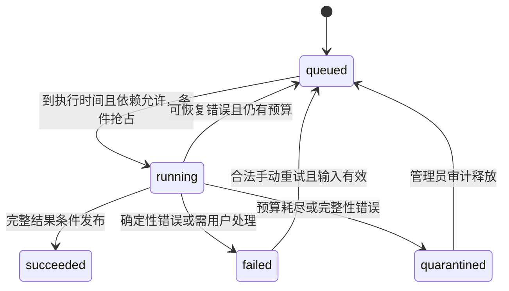

# 08 持续故障自动隔离：有限重试与依赖熔断

> 状态：实施指南，尚未实现。建议先完成 [07 监控与执行历史](07_队列监控.md)，并遵守文件登记、配额和保留期规则。

## 1. 当前行为与目标

当前 [jobs.py](../app/jobs.py) 的 `recover_expired()` 将过期 running 直接改回 queued，没有次数上限；`queued_ids()` 不区分重试等待和隔离；API 的 failed retry 也没有重试预算。[dispatcher.py](../app/dispatcher.py) 每轮可再次投递相同 queued。

这对临时故障有恢复作用，但某个输入若每次触发 worker 崩溃，可能一直占用执行资源；共享 OSS、Redis 或配置故障也可能让所有任务不断失败。

这里需要两种独立机制：

- **任务隔离**：把特定 job 标为 quarantined，停止自动投递和执行，保存原因、证据与审计。
- **依赖熔断**：共享依赖异常时暂停使用该依赖的动作，让正常任务留在队列等待，避免把所有任务都错判为坏任务。

隔离不是沙箱。遇到不可信文件引起内存/CPU 问题时，还需要容器资源限制和处理规模控制；本方案只限制重复消耗与调度扩散。

## 2. 先建立错误分类

建议新增 `app/errors.py`，产生受控 error_code、category、dependency、retryable、safe_message。分类以实际异常和接口响应为依据，不按异常文本模糊匹配后无限重试。

| 错误 | 建议归类 | 策略 |
| --- | --- | --- |
| CSV 缺字段、日期格式不符、没有有效行 | data_validation | failed，不自动重试；用户修改后新建任务 |
| 用户空间不足 | quota_exceeded | failed，清理空间后可显式重试 |
| OSS 连接暂时失败、限流等可恢复响应 | dependency_transient | 有限重试；多任务同时出现时触发依赖熔断 |
| OSS 认证/权限配置错误 | dependency_config | 暂停相关依赖，通知管理员，避免高频试错 |
| DB 事务结果未知 | commit_unknown | 先按 operation/token 复核，不盲目改 failed 或删文件 |
| 活跃输入缺失、校验和不一致 | data_integrity | 立即隔离，调查引用与存储，不能生成空报表 |
| 未知程序错误反复出现 | internal_error | 有限重试后隔离，保留错误指纹 |
| 进程失联/租约过期 | worker_lost | 计入当前重试预算，达到上限隔离 |
| 文件已过保留期 | files_expired | 不执行、不重试，遵守 03 的访问与回收规则 |

用户可见文本不包含凭证、SQL、对象签名 URL 和完整堆栈；管理员日志使用 request_id、job_id、run_token 与错误枚举定位。

## 3. 建议任务字段与执行状态

在现有四态中新增 `quarantined`，同步数据库 CHECK 约束、`JobStatus`、筛选、UI 和测试。

| 字段/模型 | 用途 |
| --- | --- |
| `Job.next_run_at` | 最早可执行时间，初次提交为当前时间 |
| `Job.dispatch_generation` | 每次重新排队增加，拒绝旧代次消息 |
| `Job.retry_cycle/retry_cycle_attempts` | 当前恢复周期与周期内真实抢占次数 |
| 现有 `attempt_count` | 生命周期真实抢占总次数，管理员释放也不清零 |
| `Job.last_error_code/last_error_category` | 结构化分类，不靠用户提示推断 |
| `Job.quarantined_at/quarantine_reason` | 隔离时间和原因 |
| `JobAttempt` | 每次执行、错误、租约失联证据，复用 07 |
| `JobAudit` | 操作者、动作、原因、前后状态、时间、request_id |

建议每个恢复周期最多真实执行 3 次，包含第一次。可恢复故障后，第二次等待约 30 秒、第三次约 120 秒，并加有上限的小范围抖动；这些是初始策略，需要按依赖恢复时间与用户等待目标调整。

`dispatch_count` 只记录发消息次数，不消耗执行预算。没有抢占成功的重复消息也不增加 attempt_count。不要把旧任务累计 attempt_count 直接当作新策略的周期预算，迁移时需明确建立当前周期。

queued 因依赖熔断停留时不增加执行次数。quarantined 是终态：释放活跃任务槽位，设置文件保留期；调查期间需要延长保留时通过 03 的审计保留规则处理。

## 4. 单任务有限重试流程

1. dispatcher 只选择 queued、文件可用、next_run_at 已到且相关依赖允许的任务。
2. 消息至少包含 `job_id` 与 `dispatch_generation`，不包含用户文件内容、密码或签名 URL。
3. `claim_job()` 再次检查上述条件与 generation，原子设置新 run_token、租约，attempt_count 和 retry_cycle_attempts 各加 1；同时创建 Attempt。
4. 执行成功时保持现有 token 围栏，并按 01/02 一次发布清单与账务。
5. 执行失败时分类，关闭本次 Attempt。确定性错误进入 failed；需要隔离的完整性错误直接 quarantined。
6. 可恢复错误且剩余预算允许：将 Job 改 queued，next_run_at 设置退避时间，dispatch_generation 增加，清空 run_token/租约，保留逻辑活跃槽位。
7. 预算耗尽：置 quarantined，记录原因、finished_at 和文件保留期，幂等释放槽位。旧执行对象单独进入清理，不能发布或覆盖新清单。

终结本次执行与写入下次状态必须是一个事务。若数据库提交结果不确定，先复查当前 token、generation、Attempt 与结果引用，不能凭本地异常直接重试或删除。

## 5. 过期租约恢复也必须遵守预算

当前 `recover_expired()` 是批量无条件回 queued，需要改为有限批次逐任务或可表达等价规则的条件更新。

1. 查出候选后锁定 Job，重新判断 status、lease_expires_at 和 run_token，防止续约刚刚成功。
2. 将旧 Attempt 标记 worker_lost；失去租约的操作不得再发布。
3. 根据当前周期真实执行次数判断重新排队或 quarantined；重新排队时设置 next_run_at、增加 dispatch_generation。
4. 如需槽位/保留期变更，按总览锁序与唯一账务事件一起提交。
5. 旧进程后来完成，仍必须在 finish 的 token 检查中失败，它不能把 quarantined 改回 succeeded。

worker 被系统杀死时通常没有 Python 异常可分类，租约恢复就是识别反复崩溃的兜底。连续三次失联后隔离，并在日志中结合容器退出原因调查内存、CPU 或程序缺陷。

## 6. 防止历史消息绕过退避与隔离

只改 `queued_ids()` 不够。Redis 里可能已有旧消息，API 还可以手动 retry，旧 worker 也可能继续执行。

需要同时修改以下入口：

- dispatcher 扫描：检查状态、时间、文件与依赖；可用 last_dispatched_at 限制同代次重复投递频率。
- Celery 消费：传入 generation；旧代次或非 queued 消息直接跳过并正常确认。
- claim_job：再次检查 generation、next_run_at、预算、依赖与输入，不能只检查 queued。
- recover_expired：遵守同一预算和退避，不能重新制造无限重排。
- 普通 retry：只允许具有可操作错误的 failed，不允许对 quarantined 通过普通入口重置预算。
- 管理员 release：受控增加 retry_cycle、清零周期次数、保留生命周期次数，产生新 generation。
- local_loop：复用完全相同的选择与抢占服务，不能本地模式跳过所有规则。

业务重试由数据库调度统一负责，不再同时使用 Celery `self.retry()` 或 `autoretry_for` 建立第二套预算。Celery 的 acks_late/reject_on_worker_lost 用于交付层恢复，不能取代业务规则；官方也提醒 worker lost 重投递可能形成消息循环，见参考 [4]。

投递采用“短事务预留投递窗口 → 事务外 send_task → 记录结果”。发送前后崩溃都允许以后重投，但重复消息受 generation 与 token 围栏保护；不能把预留窗口当作永久已投递标记。

## 7. 共享依赖熔断流程

建议新增 `DependencyCircuit`：dependency、state(closed/open/half_open)、window_started_at、failure_count、distinct_job_count、opened_at、next_probe_at、probe_owner、probe_lease_expires_at、version、last_error_code。

同时登记有唯一 source_event_id 的 `DependencyFailure`，记录依赖、观察窗口、job_id、run_token、错误枚举和时间。错误上报重放不能重复增加窗口计数；不同 job 的数量从窗口内去重记录计算，不能只用一个整数猜测。业务状态与熔断统计一起变更时，先锁 DependencyCircuit，再按总览顺序锁任务相关表。

首版可以使用数据库维护一个明确的 60 秒观察窗口：同依赖至少 3 个不同 job 出现共 5 次可恢复错误时 open；这是示例阈值，不是精确滑动窗口算法。单个坏文件的 5 次错误不能自动熔断所有 OSS 工作。

上述“不同 job”门槛用于区分存储故障与单任务毒数据。broker 连通性错误不由 CSV 内容引起，可采用独立的投递失败阈值或直接依赖探测，避免 dispatcher 一直尝试首个任务导致永远凑不够 3 个 job；认证/权限等确定配置错误则按分类立即暂停。

完整流程：

1. **closed**：允许正常执行，失败按依赖枚举计数。权限配置错误可立即 open 并要求人工修复。
2. **open**：不再启动使用该依赖的新动作，相关任务保持 queued。正在运行的动作可能失败一次，按任务规则保存结果；熔断不能追溯取消已经发出的请求。
3. **到达 next_probe_at**：一个维护实例通过数据库条件更新取得 probe_owner 与有期限的探测权，进入 half_open；其他实例继续暂停。
4. **half_open**：只允许受控探测，采用真实依赖所需的代表性动作。OSS 写探测用专属系统前缀的小对象，确认写读并删除，费用归系统，不占某用户配额。
5. **探测恢复**：例如连续两次成功后 closed，分批放量；失败则回 open 并按有上限的策略延后探测，保留原因。

探测成功和失败都带 owner/version 条件，防止失去探测租约的旧实例关闭新熔断状态。健康 ping 成功不一定证明写入权限已经恢复，必须验证发生故障的能力。

不同依赖分别控制：broker 熔断暂停 dispatcher 发消息，OSS 熔断暂停相关存储动作，邮件熔断只影响发信。不要让邮件故障暂停 CSV。

数据库不可用时，无法可靠写入数据库熔断状态；进程应停止新抢占/发布并报告依赖故障，已有操作保留待确认。数据库恢复后由租约与引用复核接续，不能宣称“数据库断开期间仍准确维护共享熔断计数”。

## 8. 隔离后的人工恢复

建议新增管理员接口：

- `GET /api/admin/jobs?status=quarantined`：分页查看原因、周期次数、Attempt 与文件期限。
- `POST /api/admin/jobs/{id}/release`：必须填写修复原因，检查输入完整、未过期、未进入删除、配额/槽位允许，并确认依赖已恢复。
- 管理依赖 reset/probe 接口：显式权限与审计，不能允许普通用户关闭全局熔断。

当前 User 没有管理员字段。先引入受控 `is_admin` 或角色模型，初始化管理员通过服务端管理命令；不能让注册请求自行传 is_admin，也不能仅凭前端隐藏按钮授权。

释放时：先在权限入口确认真实管理员身份，再按统一顺序锁熔断、配额和 Job → 检查输入与依赖 → 取得任务槽位 → 增加 retry_cycle 与 generation → 设置 queued/next_run_at → 清除当前隔离标志并写 JobAudit → 提交。建议管理员修复后的 release 不扣普通用户每日提交次数，但仍检查空间与槽位，管理员操作另做频率限制。历史原因保留在审计和 Attempt，不覆盖删除。

quarantined 文件已到期或丢失时拒绝释放，提示重新上传。不得自动从其他用户相同 SHA-256 文件中取数据修复，避免越权。

## 9. 按文件修改

| 位置 | 改动 |
| --- | --- |
| `app/models.py`、Alembic | 新状态约束、周期/代次/退避字段、Circuit、Audit |
| `app/schemas.py` | JobStatus 加 quarantined、公开可重试原因与 next_run_at；管理详情分开 |
| 建议新增 `app/errors.py` | 异常到结构化类别的映射 |
| 建议新增 `app/retry_policy.py` | 预算、退避、状态迁移；普通 retry 与恢复器共同调用 |
| 建议新增 `app/circuits.py` | 共享熔断、唯一探测权、依赖恢复 |
| `app/jobs.py` | claim/finish/recover 与 local_loop 全入口一致 |
| `app/dispatcher.py`、`app/celery_app.py` | 消息带 generation，过滤延迟和隔离，旧消息安全跳过 |
| `app/api.py`、建议新增管理模块 | failed retry 资格、受控 release 和审计 |
| `app/static/app.js` | 状态中文名、筛选、下一次执行时间、隔离原因；普通用户看不到管理按钮 |
| 07 指标 exporter | 隔离量、自动重试、依赖熔断、探测与拒绝旧消息统计 |
| `app/config.py`、`.env.example`、Compose | 最大执行次数、退避、窗口、熔断与探测策略，显式传参 |

不直接修改历史 `0001`。新 CHECK 约束应先兼容旧四态，部署能读五态的所有服务后再启用隔离写入。

## 10. 上线与回滚

1. 先部署只分类、记 Attempt、记录“本会隔离”的观察版本，不改变调度。
2. 新增字段回填：初次 next_run_at、generation，给存量任务建立明确周期，不因历史次数误隔离。
3. 消息协议切换需要停旧 dispatcher、等待旧 worker 结束或受控停机，再发布支持 generation 的所有消费者；旧格式消息按迁移规则丢弃，由数据库重新投递。不能让会忽略代次的新旧 worker 长期混跑。
4. 先在测试任务启用预算与隔离，再启用依赖熔断；观察成功率、等待时间和误隔离。
5. 回滚优先关闭“新自动隔离/新熔断”的策略开关，继续保留 token、generation、五态读取和审计。

已有 quarantined 不能自动全部改 queued；需要逐项释放。数据库 downgrade 无法无损把五态压成四态，必须先导出/处理隔离记录并评估数据转换。不能承诺关闭功能后旧版程序立即兼容。

## 11. 验收场景

| 场景 | 预期结果 |
| --- | --- |
| 一个文件连续让 worker 被杀 | 达到真实执行预算后 quarantined，其他任务继续 |
| DataValidationError | 一次 failed，不自动消耗多次预算 |
| OSS 整体不可用 | 多任务依赖错误触发熔断，新任务保留 queued，不批量误隔离 |
| 单个坏任务反复错误 | 不因同一个 job 就把所有依赖打开 |
| 延迟重试期间收到旧消息 | generation/time 校验拒绝，次数不增加 |
| 隔离后旧 worker 返回成功 | token/status 检查拒绝，不能覆盖隔离 |
| 普通用户调用 retry 或管理员 release | 前者不能绕过隔离，后者必须通过真实管理员权限 |
| 两个管理员同时释放 | 只有一个新周期/槽位/审计动作生效 |
| 两个维护实例同时 half_open | 仅当前 probe_owner 有探测权 |
| 探测持有者失联 | 到期可接管，旧探测不能关闭新状态 |
| 输入过期或删除中 | release/retry 拒绝，不创建无法执行任务 |
| 数据库提交确认丢失 | 复查引用与代次，不重复发布、不误清理 |
| local 与 Celery 执行相同故障序列 | 相同业务状态、预算和保留期结果 |

## 12. 官方参考

1. [Celery Tasks：acks_late、retry 与 worker lost](https://docs.celeryq.dev/en/stable/userguide/tasks.html)：交付语义、重试与重投递风险。
2. [PostgreSQL 17 行锁](https://www.postgresql.org/docs/17/explicit-locking.html)：共享状态认领和事务并发控制。
3. [Celery Monitoring](https://docs.celeryq.dev/en/stable/userguide/monitoring.html)：事件与运行观测。
4. [Celery task_reject_on_worker_lost 配置](https://docs.celeryq.dev/en/stable/userguide/configuration.html#task-reject-on-worker-lost)：worker 异常退出后的确认与重投递风险。

资料核对日期：2026-10-27。任务预算、状态机和数据库熔断是本项目提出的方案，不是 Celery 自动提供的现成功能。
