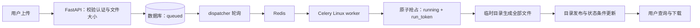

# DataClean：异步数据处理与报表平台

一个面向 Python 后端岗位的完整学习项目：用户注册登录后上传销售 CSV，系统在后台校验、清洗、去重、统计，保存任务历史，并提供清洗数据、统计表和异常明细下载。提供可操作的网页和 Swagger API 文档。

技术栈：Python 3.13、FastAPI、SQLAlchemy 2、pandas、Alembic、Argon2、JWT；容器模式使用 PostgreSQL 17、Redis 7、Celery 5。Windows 本地模式使用 SQLite 与数据库任务队列，无需启动 Redis。

## 1. 启动

所有命令均在 `D:\grow\langchain\dataclean` 下执行。项目依赖独立管理，不修改上一级 LangChain 的依赖清单。

### Windows 本地模式

当前工作目录已创建 `.venv`、本地 `.env` 和随机密钥，可以直接执行最后两条命令。全新克隆时执行：

```powershell
cd D:\grow\langchain\dataclean
& D:\conda\envs\langchain\python.exe -m venv .venv
& .\.venv\Scripts\python.exe -m pip install -r requirements-dev.txt
Copy-Item .env.example .env
& .\.venv\Scripts\python.exe -c "import secrets; print(secrets.token_hex(32))"
# 将生成值填入 .env 的 DATACLEAN_JWT_SECRET，替换占位符。
& .\.venv\Scripts\python.exe -m app.manage init-db
& .\.venv\Scripts\python.exe -m uvicorn app.main:create_app --factory --host 127.0.0.1 --port 8000
```

打开 [工作台](http://127.0.0.1:8000/) 或 [API 文档](http://127.0.0.1:8000/docs)，注册账号后上传 `examples/sales.csv`。JWT 仅保存在网页内存，刷新页面后需要重新登录。停止服务使用 `Ctrl+C`。

本地模式的后台线程扫描数据库，业务处理不在上传请求中执行；提交立即返回任务编号。SQLite 数据保存在 `data/dataclean.db`，输入和结果保存在 `data/files`。本地模式用于学习与单机演示。

### Docker 模式：PostgreSQL + Redis + Linux Celery

先启动 Docker Desktop 的 Linux 引擎。在 `.env` 中保留随机 `DATACLEAN_JWT_SECRET`，额外添加随机十六进制 `POSTGRES_PASSWORD`（同上生成）。本次已自动生成这两个本地值，均被 Git 忽略。

```powershell
docker compose up --build -d
docker compose ps
docker compose logs -f api worker dispatcher
```

工作台仍是 `http://127.0.0.1:8000/`。Compose 自动执行迁移，API、dispatcher、Celery worker 共享文件卷。PostgreSQL 与 Redis 只在 Compose 内网开放；网页端口绑定本机。容器使用固定的项目依赖版本和非 root 应用用户。

`.env` 中本地的 SQLite / local 配置由 Compose 的 PostgreSQL / celery 环境变量覆盖，所以本地与容器两套数据独立。两种模式同时运行时，将本地端口改为 `8001`。

```powershell
# 保留数据库和文件，仅停止项目容器
docker compose down
# 查看健康状态与日志
docker compose ps
docker compose logs --tail 50 worker dispatcher
```

## 2. CSV 约定与清洗规则

输入为 UTF-8（支持 BOM）CSV，必须包含下列五列；列顺序可以改变，列名前后空白会去除，不接受额外列或重复列名。

| 字段 | 含义与约束 |
| --- | --- |
| `order_id` | 必填销售记录编号；本项目假设一行就是一条独立销售记录 |
| `order_date` | 有效日期，严格 `YYYY-MM-DD` |
| `product` | 必填商品名 |
| `quantity` | 十进制整数，1～1,000,000 |
| `unit_price` | 0～1,000,000，最多两位小数；不接受负数、NaN、Infinity、科学计数法 |

```csv
order_id,order_date,product,quantity,unit_price
S001,2026-10-01,键盘,2,199.90
S002,2026-10-01,鼠标,3,59.90
```

- 去除字段两端空白；异常值所在行写入 `rejected.csv`，包含 CSV 记录序号和原因。
- 在有效行中按 `order_id` 去重，保留首次有效记录；后续相同编号即使金额不同也算重复。本项目不支持一张订单多行商品；此时应先为每条明细提供唯一记录编号。
- 金额使用整数分运算与 Python 整数汇总，JSON / CSV 导出金额为两位小数字符串，避免浮点误差。
- 统计保留行的记录数、商品件数、销售额，并按商品、日期汇总。
- CSV 列数不匹配、引号不完整、编码错误、表头错误，或者没有任何有效行：整个任务失败，不发布部分结果。有效行与异常行并存时可以成功。
- 空文件在上传时返回 `400`；默认单文件上限 10 MiB，超出返回 `413`。multipart 总请求体另保留 64 KiB 表单开销上限，并在解析过程中检查。
- 下载的 CSV 对用户提供的 `= + - @` 起始单元格加单引号，防止表格公式执行；JSON 报表保留原始文本，网页通过 `textContent` 展示。

示例 `examples/sales.csv` 的验收结果：输入 8 行，保留 4 行、异常 3 行、去重 1 行，总数量 7，总金额 **2078.40**。

成功任务生成四个文件：

| 下载类型 | 文件 | 内容 |
| --- | --- | --- |
| `cleaned` | `cleaned.csv` | 清洗后的五列及 `total_amount` |
| `statistics` | `statistics.csv` | 按商品统计记录数、数量、销售额 |
| `report` | `report.json` | 总览、按商品及按日期统计 |
| `rejected` | `rejected.csv` | 被剔除的异常行及原因；没有异常时仅包含表头 |

## 3. API

除注册、登录、示例文件与健康检查外，API 需要 `Authorization: Bearer <token>`。Swagger 的 Authorize 可以直接输入用户名和密码。

| 方法 | 路径 | 行为 |
| --- | --- | --- |
| POST | `/api/auth/register` | JSON `username`、`password`；成功 201，用户名冲突 409 |
| POST | `/api/auth/token` | OAuth2 表单 `username`、`password`，返回 JWT |
| GET | `/api/auth/me` | 当前用户 |
| POST | `/api/jobs` | multipart 字段 `file`；首次提交 202，返回 `queued` 任务 |
| GET | `/api/jobs` | `page`、`page_size`（1～100）、可选 `status`；返回总数与列表 |
| GET | `/api/jobs/{id}` | 自己的任务状态、文件信息、摘要、错误与时间 |
| POST | `/api/jobs/{id}/retry` | 仅允许 `failed` 原子转回 `queued`；其他状态 409 |
| GET | `/api/jobs/{id}/download/{artifact}` | 四类结果之一；未成功 409 |
| GET | `/health` | API 与数据库连接检查；不代表队列与工作进程健康 |

用户名为 3～50 位 ASCII 字母、数字、下划线，按小写保存；密码 8～128 位，Argon2id 哈希存储。JWT 使用固定 HS256 算法、签发者与必填过期时间检查，默认一小时有效。该学习版本未加入刷新令牌或退出后的服务端令牌撤销。

## 4. 一致性与面试要点



1. **重复提交**：默认用文件 SHA-256 作为幂等键，也允许请求头 `Idempotency-Key`。数据库唯一约束是 `(user_id, idempotency_key)`，因此用户间互不影响。相同键、相同内容返回已有任务（200 与 `Idempotent-Replayed: true`）；相同键、不同内容返回 409。失败后再次上传仍返回原任务，需要显式调用 retry。自定义不同键可有意重复处理同一文件。
2. **数据库与消息队列**：先保存原始文件并提交任务行，再由独立 dispatcher 投递 Celery，避免 API 提交数据库成功、发送队列失败导致任务丢失。Redis 故障时任务保持 queued，恢复后继续投递。dispatcher 默认每 2 秒扫描，单次最多 100 条，可能重复投递。
3. **并发抢占**：工作进程通过带 `WHERE status='queued'` 的 UPDATE 原子抢占。任务行是状态的唯一来源，Celery result backend 不保存另一套状态。重复消息不能让同一排队任务同时获得两个有效执行权。
4. **工作进程中断**：默认租约 300 秒，每 100 秒续约；扫描器回收过期 running 任务。租约用于检测丢失的进程，不是 pandas 处理超时限制。每次执行生成新的 `run_token`，完成/失败写回均检查它，旧进程无法覆盖后续执行。中断后通常在租约到期加一个扫描周期内重新排队。
5. **结果完整性**：输入文件先写 `.part` 再重命名。每次执行的输出先写专有临时目录，全部生成后在同一文件系统中重命名目录，再提交 succeeded。下载只接受 succeeded 记录所引用的目录；失败不暴露部分文件。数据库与文件系统之间不存在分布式事务，进程强杀可能留下未引用文件，但不会以成功状态暴露未完成结果。
6. **权限隔离**：任务详情、分页列表、重试、四种下载都通过 `user_id` 过滤；访问其他用户任务统一 404。磁盘存储使用服务端生成的 UUID，不使用上传文件名拼接路径，结果不挂载到公开静态目录。

## 5. 验证

```powershell
# 离线测试：认证、CSV、并发、失败、租约与迁移，SQLite 临时库
& .\.venv\Scripts\python.exe -m pytest -q

# 已启动服务上的真实 HTTP 流程，会创建两个测试账号与任务
& .\.venv\Scripts\python.exe scripts/smoke.py
# 本地服务使用其他端口时
& .\.venv\Scripts\python.exe scripts/smoke.py http://127.0.0.1:8001

# 仅在学习/演示用 Compose 栈执行：短暂停止 Redis 并重启 API，验证恢复与持久化
& .\.venv\Scripts\python.exe scripts/recovery_smoke.py

# 同一套测试在独立 PostgreSQL 临时容器中执行，不接触应用数据库
docker compose --profile test build tests
docker compose --profile test run --rm tests
docker compose --profile test stop test-postgres

# 迁移与模型是否一致（使用当前 .env 指向的数据库）
& .\.venv\Scripts\python.exe -m alembic check
```

测试分别覆盖 HTTP 权限、并发上传唯一约束、并发 worker 抢占、金额与异常格式、过期租约隔离、模拟磁盘失败、模拟 broker 中断、Celery 任务处理函数、上传边界、分页与数据库迁移。`smoke.py` 应分别对本地模式及 Docker 模式运行；直接调用 Celery 函数不代表真实消息队列已经验证。

如手动设置 `DATACLEAN_TEST_DATABASE_URL`，必须指向名称以 `_test` 结尾的专用空测试库：测试会执行迁移与降级，删除测试表。Compose 的 `test-postgres` 使用独立临时存储。

## 6. 目录与后续学习

```text
app/
  main.py           应用工厂、本地 worker 生命周期、网页入口
  api.py            认证、上传、任务、分页、重试、下载
  models.py         用户、任务与数据库约束
  processing.py     CSV 校验、pandas 清洗、整数金额统计
  jobs.py           抢占、租约、执行隔离、文件发布
  dispatcher.py     数据库扫描与 Celery 投递
  celery_app.py     Celery 配置与任务入口
  security.py       Argon2 与 JWT
  static/           无构建依赖的网页工作台
migrations/         Alembic 数据库版本
examples/           成功/失败示例
tests/              离线与数据库集成测试
scripts/smoke.py    真实 HTTP 验收
scripts/recovery_smoke.py  Redis 故障与 API 重启验收
```

先阅读 `processing.py` 理解清洗，再看 `api.py` 的上传与用户过滤，最后阅读 `jobs.py`、`dispatcher.py` 理解异步一致性。项目没有接入大模型，运行不调用付费 API。

此版本面向单机学习和简历演示。未实现多机对象存储、用户配额、文件保留期与自动孤儿文件清理、密码找回、登录限流、队列监控和持续故障后的自动隔离；正式公网部署还需要反向代理、HTTPS、备份和相应运维措施。租约恢复采用至少一次执行语义，依靠执行令牌保证当前结果唯一，不宣称消息恰好投递一次。

官方参考：[FastAPI JWT 与密码哈希](https://fastapi.tiangolo.com/tutorial/security/oauth2-jwt/)、[FastAPI 后台任务](https://fastapi.tiangolo.com/tutorial/background-tasks/)、[Celery Tasks](https://docs.celeryq.dev/en/stable/userguide/tasks.html)、[Celery 平台 FAQ](https://docs.celeryq.dev/en/stable/faq.html)、[SQLAlchemy UPDATE 与 rowcount](https://docs.sqlalchemy.org/en/20/tutorial/data_update.html)。
